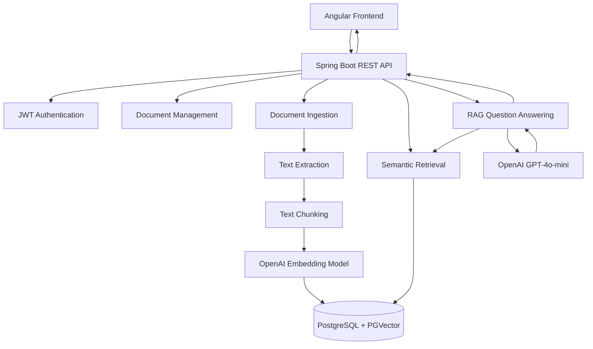

# DocuMind API — AI-Powered Document Intelligence Backend

DocuMind API is the backend service for **DocuMind**, an AI-powered document intelligence platform built using Java, Spring Boot, Spring AI, PostgreSQL, and PGVector.

It provides REST APIs for user authentication, document management, document ingestion, semantic retrieval, and Retrieval-Augmented Generation (RAG)-based question answering.

The backend integrates OpenAI models for text embeddings and contextual answer generation, while PostgreSQL with PGVector provides persistent storage and vector similarity search.

## ✨ Key Features

- **JWT Authentication:** Secure user registration, login, and token-based authentication.
- **Document Management:** Upload, retrieve, search, and download user documents.
- **Document Ingestion Pipeline:** Extract document text, split content into chunks, and generate embeddings.
- **Vector Storage:** Store document embeddings and associated metadata using PostgreSQL and PGVector.
- **Semantic Search:** Retrieve relevant document chunks through vector similarity search.
- **AI-Powered Q&A:** Generate contextual answers using retrieved document content and OpenAI language models.
- **User Data Isolation:** Ensure authenticated users can access only their own documents and associated content.
- **Persistent Storage:** Maintain database records, vector data, and uploaded documents using Docker volumes.
- **Containerized Deployment:** Run the backend and PostgreSQL database using Docker Compose.

## 🛠️ Technology Stack

| Category | Technologies |
|---|---|
| Language | Java 21 |
| Backend Framework | Spring Boot 4.0.9 |
| AI Framework | Spring AI 2.0.0 |
| Chat Model | OpenAI GPT-4o-mini |
| Embedding Model | OpenAI text-embedding-3-small |
| Database | PostgreSQL 18 |
| Vector Database | PGVector |
| Authentication | Spring Security, JWT |
| API Architecture | REST APIs |
| Build Tool | Maven |
| Containerization | Docker, Docker Compose |

## 🏗️ System Architecture



## 🔄 Document Ingestion Workflow

1. **Upload:** The authenticated user uploads a document through the frontend.
2. **Text Extraction:** The backend extracts the textual content from the uploaded document.
3. **Chunking:** Extracted content is divided into smaller text segments.
4. **Embedding Generation:** Spring AI integrates with OpenAI's `text-embedding-3-small` model to generate vector embeddings.
5. **Vector Storage:** Embeddings, document references, and associated metadata are stored in PostgreSQL using PGVector.
6. **Ingestion Status:** The document ingestion process maintains its processing status.

## 🧠 Retrieval-Augmented Generation (RAG) Workflow

1. The user submits a natural-language question.
2. The backend generates an embedding for the question.
3. PGVector performs similarity-based retrieval against stored document chunks.
4. Relevant document content is retrieved and used as contextual information.
5. The retrieved context is passed to GPT-4o-mini.
6. The model generates a context-aware response based on the retrieved information.
7. The backend returns the answer to the frontend.

## 📁 Project Structure

```text
doc-intelligence-api/
│
├── src/
│   ├── main/
│   │   ├── java/com/documind/api/
│   │   │   ├── auth/
│   │   │   │   ├── dto/
│   │   │   │   └── service/
│   │   │   │
│   │   │   ├── config/
│   │   │   ├── entity/
│   │   │   ├── repository/
│   │   │   ├── security/
│   │   │   ├── service/
│   │   │   ├── DocumentController.java
│   │   │   ├── DocumentQaController.java
│   │   │   └── DocumentRetrievalController.java
│   │   │
│   │   └── resources/
│   │       └── application.properties
│   │
│   └── test/
│
├── .dockerignore
├── .env.example
├── Dockerfile
├── docker-compose.yml
├── mvnw
├── pom.xml
└── README.md
```

## 🚀 Getting Started

### Prerequisites

Install the following:

- Java 21
- Docker Desktop
- Git
- OpenAI API key

Docker Compose is used to run the backend and PostgreSQL database together.

### 1. Clone the Repository

```bash
git clone https://github.com/Faizan-11/doc-intelligence-api.git

cd doc-intelligence-api
```

### 2. Configure Environment Variables

Create your local environment file from the example:

```bash
cp .env.example .env
```

Open `.env` and configure the following variables:

```env
# PostgreSQL configuration
POSTGRES_DB=documind
POSTGRES_USER=documind_user
POSTGRES_PASSWORD=your_database_password

# OpenAI configuration
OPENAI_API_KEY=your_openai_api_key

# JWT configuration
JWT_SECRET=your_base64_encoded_jwt_secret
```

Replace all placeholder values with your own credentials.

**Security:** Never commit your `.env` file or expose your API keys, database passwords, or JWT secret. The repository includes `.env.example` for configuration reference.

### 3. Build and Start the Application

Run:

```bash
docker compose up --build -d
```

This command builds the backend Docker image and starts the backend and PostgreSQL services.

### 4. Verify the Application

Check the running containers:

```bash
docker compose ps
```

Check backend logs:

```bash
docker compose logs -f backend
```

Verify backend health:

```bash
curl http://localhost:8080/api/health
```

Expected response:

```json
{
  "application": "DocuMind API",
  "status": "UP"
}
```

The backend API is available at:

```text
http://localhost:8080
```

## 🔌 API Endpoints

The following are the primary application endpoints.

| Method | Endpoint | Description |
|---|---|---|
| POST | `/api/auth/register` | Register a new user |
| POST | `/api/auth/login` | Authenticate a user |
| GET | `/api/documents` | Retrieve authenticated user's documents |
| GET | `/api/documents/search` | Search documents |
| GET | `/api/retrieval/search` | Perform semantic retrieval |
| POST | `/api/qa/ask` | Ask a question using RAG |
| POST | `/api/qa/documents/{documentId}/ask` | Ask a document-specific question |
| GET | `/api/health` | Check backend health |

Protected endpoints require a valid JWT access token in the Authorization header:

```http
Authorization: Bearer <your_access_token>
```

## 🐳 Docker Configuration

The backend Docker setup includes:

- **Backend Container:** Runs the Spring Boot application using Java 21.
- **PostgreSQL Container:** Runs PostgreSQL 18 with PGVector support.
- **Persistent Database Volume:** Retains database records and vector embeddings.
- **Document Storage Volume:** Persists uploaded document files.

### Service Ports

| Service | Host Port | Container Port |
|---|---:|---:|
| Spring Boot Backend | 8080 | 8080 |
| PostgreSQL | 5433 | 5432 |

### Stop the Containers

```bash
docker compose down
```

### Stop Containers and Remove Persistent Volumes

```bash
docker compose down -v
```

**Warning:** The second command removes the named database and document-storage volumes, permanently deleting their persisted data.

## 🧪 Testing

Run the backend unit and integration test suite using Maven:

```bash
./mvnw test
```

The Maven wrapper is included in the repository, so a separate Maven installation is not required.

## 🔗 Related Repository

**Frontend — DocuMind Angular Application**

[https://github.com/Faizan-11/doc-intelligence](https://github.com/Faizan-11/doc-intelligence)

The frontend provides the user interface for authentication, document management, semantic search, and AI-powered question answering.

## 👨‍💻 Author

Developed as part of DocuMind, a full-stack AI application demonstrating backend engineering, secure REST API development, vector database integration, and Retrieval-Augmented Generation.